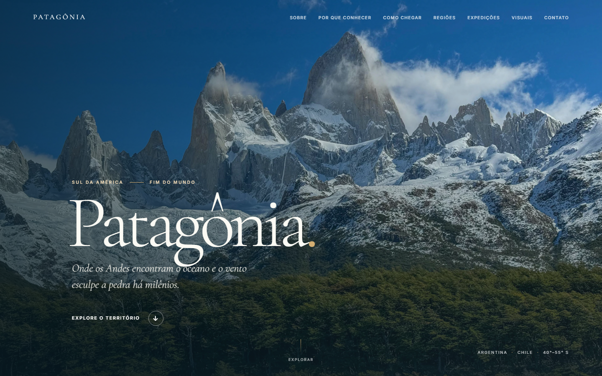
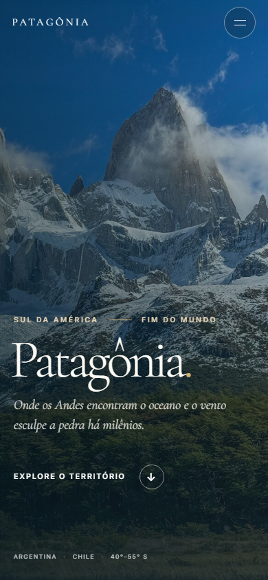

# Patagônia — expedição ao fim do mundo

Uma viagem visual pelo extremo sul da América: montanhas de granito, lagos, geleiras e caminhos entre Argentina e Chile.

[**Abrir o site publicado →**](https://ludgerios.github.io/site-patagonia-turismo/)





## A experiência

O projeto apresenta algumas das paisagens e rotas mais conhecidas da região em uma página editorial, com fotografia em destaque, leitura confortável e navegação adaptada a telas pequenas.

- Conheça Torres del Paine, Perito Moreno, Fitz Roy, El Chaltén e Ushuaia.
- Compare quatro sugestões de expedição e consulte duração, nível e temporada.
- Explore fotografias e um vídeo local do projeto.
- Use o formulário demonstrativo para simular uma consulta. Os dados ficam no navegador e não são enviados a um servidor.

## Tecnologias

HTML semântico, CSS moderno e JavaScript sem dependências de runtime. As fotografias usadas na página ficam no próprio repositório em WebP; o vídeo é servido pelo arquivo MP4 já incluído. O projeto é publicado como site estático pelo GitHub Pages.

## Executar localmente

Não há etapa de build nem instalação de dependências. Com Python 3 instalado, execute na pasta do projeto:

```bash
python -m http.server 8000
```

Abra [http://localhost:8000](http://localhost:8000). Também é possível usar qualquer servidor local de arquivos estáticos.

## Responsividade e acessibilidade

A interface foi verificada em 320, 375, 390, 430, 768, 1024 e 1440 px, sem rolagem horizontal. O menu mobile funciona por toque e teclado; links de navegação indicam a seção atual; imagens fora da primeira tela carregam sob demanda; os campos têm rótulos; há atalho para o conteúdo e estados de foco visíveis. As animações usam IntersectionObserver, não bloqueiam o conteúdo sem JavaScript e respeitam prefers-reduced-motion.

## Estrutura

```text
.
├── assets/                 # Fotografias WebP locais
├── css/style.css           # Identidade visual, layout e movimento
├── js/script.js            # Menu, navegação, revelação e formulário
├── screenshots/            # Capturas de referência
├── index.html
└── patagonia-video.mp4
```

## Créditos

As fotografias foram obtidas no Unsplash e estão incluídas em WebP para manter o site independente de links externos de imagem. Consulte a página de cada fotografia:

- [Cordilheira patagônica — Marina Zvada](https://unsplash.com/photos/a-mountain-range-covered-in-snow-and-clouds-p0IbuVnu7iA)
- [Lago e cordilheira em Torres del Paine](https://unsplash.com/photos/lake-beside-mountain-ranges-cuHNkZh7PeU)
- [Glaciar no Parque Nacional Los Glaciares — Hans-Jürgen Weinhardt](https://unsplash.com/photos/glacier-in-los-glaciares-national-park-santa-cruz-province-patagonia-argentina-5RFMPufTKPA)
- [Fitz Roy — Brice Cooper](https://unsplash.com/photos/a-snow-covered-mountain-range-under-a-cloudy-blue-sky-4QREPUxFP3E)

O vídeo MP4 faz parte dos arquivos fornecidos com o projeto original. Marcas, conteúdos e materiais de terceiros permanecem de seus respectivos titulares.

## Contexto

Projeto acadêmico de apresentação turística da Patagônia, desenvolvido originalmente para a disciplina de Ferramentas de Desenvolvimento Web. O conteúdo tem caráter informativo e demonstrativo; confirme condições, acesso e temporada diretamente com os parques e operadores locais antes de planejar uma viagem.

## Direitos e materiais de terceiros

Não foi adicionado arquivo de licença para o código original. As imagens têm as condições próprias do Unsplash; o vídeo MP4 já fazia parte do projeto original e foi mantido com autorização de publicação confirmada pelo titular.
